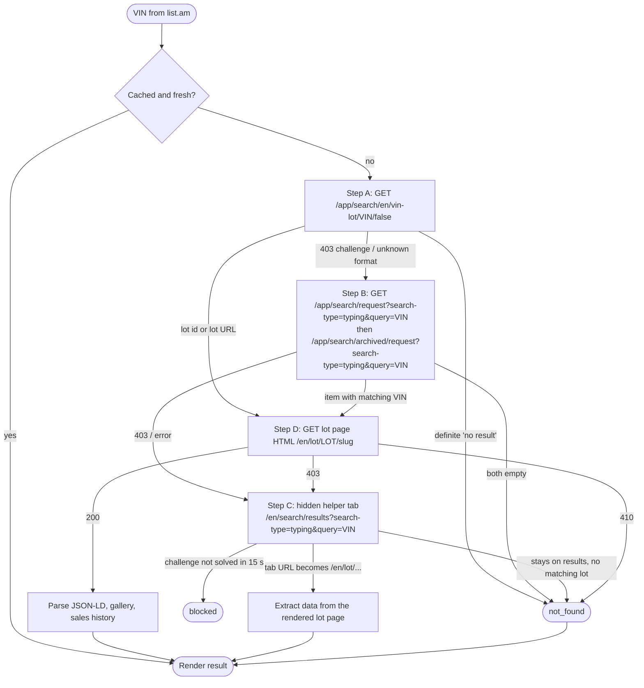

# 03 — Resolving a VIN to a bid.cars Lot (Task 2)

## The problem

The bid.cars lot URL looks like this:

```
https://bid.cars/en/lot/1-61989692/2020-Mazda-6-JM1GL1VM3L1522160
                       └───┬────┘ └──────────────┬─────────────┘
                       lot id     slug: year-make-model-VIN
```

- `1-61989692` is the lot id: prefix `1-` = Copart lot number, `0-` = IAAI stock number.
- The slug is cosmetic, but the lot id is required. list.am only has the VIN, so the
  extension cannot build this URL directly.

## What was found

### Verified from the saved bid.cars page (`../bid_cars.html`)

| Finding | Where in the page |
| --- | --- |
| The site's own search URL template is `https://bid.cars/en/search/results?search-type=typing&query={VIN}` | JSON-LD `WebSite.potentialAction.target` |
| The lot page has a JSON-LD `Vehicle` block with VIN, lot URL, make, model, year, colour, transmission, damage, sale date, and a description containing location and odometer | `<script type="application/ld+json">` with `"@type": "Vehicle"` |
| Canonical lot URL | `<meta property="og:url">` |
| Full-size photos are `https://mercury.bid.cars/{lotId}/{slug}-{n}.jpg`, n = 1..N | `.f-carousel__slide[data-src]` inside `#productContainer` |
| A photo ZIP endpoint exists: `https://bid.cars/app/lot/{lotId}/images` (link is commented out in the page) | HTML comment near the gallery |
| Search APIs used by the site's menus: `/app/search/request?...` (current auctions) and `/app/search/archived/request?...` (archived auctions) | `data-sec-preload` attributes in the nav menu |
| The page marks archived lots: `var isArchived = 1;` and "Auction ended on …" message | Inline script, `#archieved-message` |
| The "Sales History" table lists every auction of the same VIN | Section "Sales History" |

### From public documentation of third-party bid.cars integrations (not verified by us)

| Endpoint | Purpose |
| --- | --- |
| `GET https://bid.cars/app/search/en/vin-lot/{VIN}/false` | The site's own **VIN → lot** lookup, used by its search box when you type a VIN. This is the request behind the "paste VIN → redirect to lot page" behaviour. |
| `GET https://bid.cars/app/search/request?search-type=typing&query={VIN}` | JSON search over **current** auctions. Each item has `lot`, `vin`, `url`, `image`, `images[]`, odometer, damage, etc. |
| `GET https://bid.cars/en/lot/{lotId}/{slug}` | Lot page. An unknown lot returns HTTP **410**. |

### Cloudflare

Every bid.cars URL (pages, `/app/...` endpoints, `/js/...`, even `images.bid.cars/`) returned
`HTTP 403 — "Just a moment..."` (Cloudflare bot challenge) when requested with `curl`. That is
why the exact JSON response of `vin-lot` could not be inspected from here.

In the extension this matters less, because:

- requests from the extension's service worker go out from the user's real Brave browser, with
  its real user agent and IP, and
- with `host_permissions` for `bid.cars` and `credentials: "include"`, they carry the user's
  bid.cars cookies, including `cf_clearance` (the cookie Cloudflare sets after a passed check).

It is still not guaranteed (Cloudflare can challenge non-navigation requests), so the
strategy below ends with a fallback that is a real browser navigation.

## Strategy: layered lookup

The service worker tries each step in order and stops at the first one that gives a definite
answer ("found" or "not found"). A Cloudflare challenge or an unexpected response is **not** a
definite answer; it moves on to the next step.



### Step A — the site's VIN → lot lookup

```js
const res = await fetch(`https://bid.cars/app/search/en/vin-lot/${vin}/false`, {
  credentials: "include",
  headers: { "X-Requested-With": "XMLHttpRequest", "Accept": "application/json, text/plain, */*" },
});
```

How to read the response is **to be confirmed** (see "Verification task" below). Handle these
shapes defensively:

- JSON containing a lot id matching `/^[01]-\d+$/` or a URL containing `/en/lot/`: found.
- A redirect (`res.redirected` and `res.url` contains `/en/lot/`): found.
- Empty body, `false`, `null`, `[]`, or 404/410: not found.
- HTML starting with `<!DOCTYPE html>` and containing "Just a moment": Cloudflare, go to Step B.

### Step B — search APIs

1. `GET /app/search/request?search-type=typing&query={VIN}` (current auctions).
2. If no match: `GET /app/search/archived/request?search-type=typing&query={VIN}` (archived).

In both, only accept an item where `item.vin === vin` (the typed search also matches partial
text). Pick the item with the newest sale date; keep the others for `otherLots` (FR-8).

> Third-party docs say archived search is account-gated for anonymous users. If it returns no
> data while not logged in, Step A or C has to cover archived lots. Most list.am cars will be
> **archived** lots (already sold and shipped), so archived coverage is the important part.

### Step C — hidden helper tab (always-works fallback)

This copies exactly what the user does by hand, so it works whenever the website works in the
browser:

1. `chrome.tabs.create({ url: "https://bid.cars/en/search/results?search-type=typing&query=" + vin, active: false })`
2. Watch `chrome.tabs.onUpdated` for that tab:
   - URL matches `https://bid.cars/*/lot/*`: found. Run `chrome.scripting.executeScript`
     with `bidcars.js` to extract the lot data (same parser as Step D), then close the tab.
   - URL stays on `/search/results` and the page has finished loading: inject a small script
     that looks for a result link whose text or href contains the VIN. Link found: navigate there.
     No link: not found.
   - Still on a Cloudflare challenge after 15 s: close the tab, status `blocked` (scenario S11).
3. Only one helper tab at a time; lookups queue behind it.

Open the tab with `active: false` so the user isn't pulled away from list.am. A tab with
`chrome.tabs.update({ autoDiscardable: false })` and a muted state avoids side effects.
(An offscreen document or `<iframe>` does not work here: bid.cars pages cannot be framed, and
Cloudflare checks need a top-level navigation.)

### Step D — parse the lot page

Fetch the HTML from the service worker, forward it to the list.am content script, and parse it
there with `DOMParser`. The selectors are in [05-dom-reference.md](05-dom-reference.md). Short version:

| Field | Source |
| --- | --- |
| VIN, make, model, year, colour, transmission, damage, sale date, canonical URL | JSON-LD `@type: "Vehicle"` |
| Lot id | from the canonical URL: `/en/lot/([01]-\d+)/` |
| Auction house | lot id prefix (`0-` IAAI, `1-` Copart) or "Sales History" table |
| Photos | `#productContainer .f-carousel__slide[data-src]` (fallback: `img[src*="mercury.bid.cars/{lotId}/"]`) |
| Location, seller, sale document | "Location:", "Seller:", "Sale Document:" rows in the right-side info box |
| Odometer, primary/secondary damage, key, start code | labelled rows in the vehicle info box; odometer also in JSON-LD `description` |
| Archived? | `var isArchived = 1` or `#archieved-message` present |
| Other auctions of the same VIN | rows of the "Sales History" table |

Always confirm that the VIN on the parsed page matches the VIN that was searched before
showing it, to protect against a wrong redirect.

### Photo fallback without parsing

If parsing the gallery fails but the lot id and slug are known, the photo URLs follow a stable
pattern and can be probed: `https://mercury.bid.cars/{lotId}/{slug}-1.jpg`, `-2.jpg`, … until the
first 404 (cap at 30).

## Verification task (do this once, before coding Step A)

Takes about 2 minutes in Brave:

1. Open <https://bid.cars/> and open DevTools → **Network**, filter **Fetch/XHR**.
2. Paste `JM1GL1VM3L1522160` into the site's search box and press Enter.
3. Find the request to `vin-lot` (or whatever request runs right before the redirect to
   `/en/lot/1-61989692/...`).
4. Write down in this file: full request URL, method, notable request headers
   (`X-Requested-With`, CSRF token?), response status and response body.
5. Repeat with a VIN that does not exist (e.g. `1HGCM82633A000000`) to see the "not found"
   response shape.
6. Repeat step 2–3 for `/app/search/archived/request?search-type=typing&query=JM1GL1VM3L1522160`
   while logged out, to see if archived search works anonymously.

Result (to fill in):

```
vin-lot request:   GET https://bid.cars/app/search/en/vin-lot/JM1GL1VM3L1522160/false
status:            ...
response (found):  ...
response (absent): ...
archived search anonymous: works / gated
```

## Recommendation

- Build **Step C (helper tab) first.** It needs no undocumented API, follows the exact manual
  flow that is known to work, and handles Cloudflare on its own. It is enough for a working v1.
- Then add **Step A** as the fast path once the verification task confirms the response format.
  When it works, lookups take one small request instead of loading a whole page.
- Step B is optional: useful for active (not yet sold) lots and as a second fast path.
