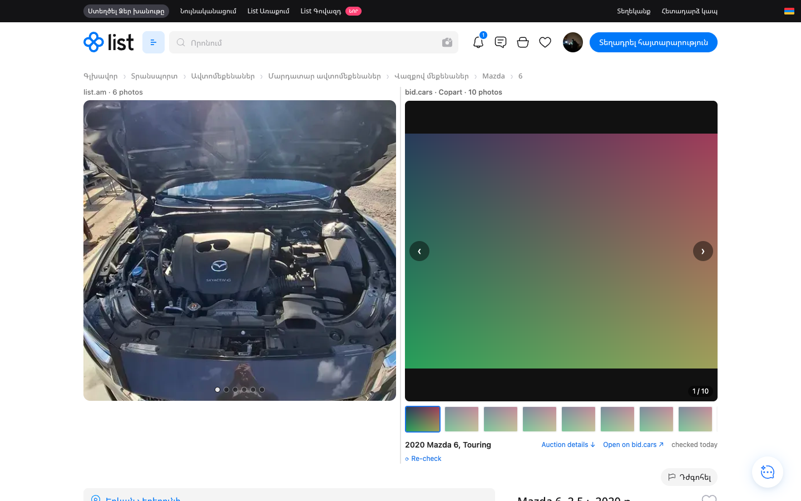

# 04 — Side-by-Side Photo Layout (Task 3)

## Goal

On a list.am car listing, show the **seller's photos** and the **auction photos** next to each
other across the full page width, at the same height, so the same angles of the car can be
compared without switching tabs. Car details and the seller card move below the photos.

## Page structure

Relevant part of the list.am item page:

```
div#main.pvp                                   (position: relative, 1140px wide)
├── div#sstar                                  ← "save" heart, absolutely positioned in #main
└── div.pmain.post-view-layout                 ← CSS grid: 740px | 360px, gap 40px
    ├── div.post-view-content-column           (grid column 1)
    │   └── div#pcontent > div.vi              ← car information
    │       ├── div.vit                        ← gallery wrapper
    │       │   └── div#po145 / #po147 …       (data-testid="listing-image-gallery"; the id number changes)
    │       ├── div.vih, div.po107, div.gt, div.attr.g.new …   (location, labels, car details, VIN tile)
    │       └── …
    └── div#pmenu                              (grid column 2) ← title, price, reviews, seller card
```

Because `.pmain` is already a two-column grid, the target layout only needs one new full-width
row on top:

```
┌──────────────────────────────┬──────────────────────────────┐
│                              │                              │
│   list.am photos             │   bid.cars auction photos    │   row 1: .lavc-split, grid-column 1 / -1
│   (list.am's own slider)     │   + thumbnails + summary     │
│                              │                              │
├──────────────────────────────┼──────────────────────────────┤
│                              │                              │
│   car information (.vi)      │   seller information         │   row 2: list.am's own columns
│   740px                      │   (#pmenu) 360px             │
│                              │                              │
└──────────────────────────────┴──────────────────────────────┘
```

## How the extension builds it

1. A `.lavc-split` container is created with two columns. list.am's `div.vit` is moved into the
   left column, untouched (the slider, dots, arrows and fullscreen keep working). A comment node
   marks the gallery's original position.
2. **Found:** `.lavc-split` becomes the first child of `.pmain`, and `.pmain` gets the class
   `lavc-layout`. CSS gives the split `grid-column: 1 / -1`, so the content column and `#pmenu`
   flow into row 2 automatically.
3. **Any other state** (loading, not found, invalid VIN, blocked, error, manual VIN input): the
   split goes back to the gallery's original position inside `.vi`, collapsed to one column with a
   slim status bar under the gallery. The page looks like normal list.am. The layout only changes
   when there are auction photos to show, so a slow "not found" never makes the page jump back.
4. After every switch, a `resize` event is dispatched. list.am's slider recalculates its slide
   width from its container (740px becomes about 562px). `.vit` and the gallery are forced to
   `width: 100% !important` in the found state, because list.am's CSS pins them at 740px.
5. The auction photo box gets the same height as the list.am gallery (`--lavc-gallery-h`, read
   from the gallery's `offsetHeight`), so both main photos line up.
6. `#sstar` (the heart) is styled only as a child of `#main`, so it's not moved. Its `top` is
   shifted by the distance `#pmenu` moved down, keeping it next to the title. A `ResizeObserver`
   on the split keeps it aligned when photos load or the window resizes.

```html
<div class="pmain post-view-layout lavc-layout">
  <div class="lavc-split" data-state="found">          <!-- added, spans both grid columns -->
    <div class="lavc-col lavc-col--listam">
      <div class="lavc-col-title">list.am · 6 photos</div>
      <div class="vit"> … untouched list.am gallery … </div>
    </div>
    <div class="lavc-splitter"></div>
    <div class="lavc-col lavc-col--history" id="lavc-history">
      <div><!-- Shadow DOM: auction gallery + summary --></div>
    </div>
  </div>
  <div class="post-view-content-column"> … car information … </div>
  <div id="pmenu"> … title, price, seller … </div>
</div>
```

## Wireframes

### Found (desktop, page wider than ~1024 px)

```
┌───────────────────────── list.am · 6 photos ───────┬──────── bid.cars · Copart · 10 photos ─────┐
│                                                    │                                            │
│            [ list.am main photo ]                  │          [ auction main photo ]            │
│              (list.am's own slider)                │          ‹                      ›          │
│                                                    │                                            │
├────────────────────────────────────────────────────┼────────────────────────────────────────────┤
│                                                    │ ▢ ▢ ▢ ▢ ▢ ▢ ▢ ▢ ▢ ▢   (thumbnail strip)    │
│                                                    │ 2020 Mazda 6, Touring                      │
│                                                    │ Copart · lot 1-61989692 · archived         │
│                                                    │ Trenton (NJ) · 42,090 mi (67,737 km)       │
│                                                    │ Damage: Front end / Rear                   │
│                                                    │ ⚠ Listing says "not damaged" …            │
│                                                    │ Open on bid.cars ↗   · checked today ⟳    │
└────────────────────────────────────────────────────┴────────────────────────────────────────────┘
┌─────────────── car information (740px) ────────────┐   ┌──── title, price, seller (360px) ────┐
│ Երևան › Էրեբունի · VIN-ը նշված է                     │   │ Mazda 6, 2.5 լ, 2020 թ.          ♡   │
│ Car details … VIN [Auction history ↓]              │   │ $16,000                              │
│ …                                                  │   │ seller card, call / message buttons  │
└────────────────────────────────────────────────────┘   └──────────────────────────────────────┘
```



- Both photo columns are the same width by default. A splitter handle between them lets the
  user drag the ratio (30/70 … 70/30); the last position is saved in settings.
- The auction gallery has its own main photo + thumbnail strip. Click a thumbnail to change the
  main photo; click the main photo to open the lightbox.

### Loading

list.am's normal layout with a slim bar under the gallery: spinner + "Looking up
`JM1GL1VM3L1522160` on bid.cars…".

### Not found / error / no VIN

The page keeps list.am's normal layout (no empty column). A slim bar appears under the gallery:

```
┌──────────────── list.am gallery (740px) ───────────┐   ┌──── title, price, seller ────┐
│                                                    │   │                              │
└────────────────────────────────────────────────────┘   │                              │
 ✓ No auction history found on bid.cars for JM1GL… · Search manually ↗ · ⟳
```

| State | Bar text | Colour |
| --- | --- | --- |
| loading | spinner · Looking up `…` on bid.cars… | neutral grey |
| `not_found` | No auction history found on bid.cars · Search manually ↗ | green |
| `invalid_vin` | VIN on this listing looks invalid: `…` · Search anyway ↗ | amber |
| `blocked` | bid.cars asks for a human check · Open bid.cars ↗ · Retry | amber |
| `error` | Couldn't reach bid.cars · Retry | red |
| no VIN | (nothing, or "No VIN · Enter VIN to check" if the setting is on) | grey |

### Narrow screens (≤ 1024 px; list.am loads its mobile CSS `m-*.css` here)

The two photo columns stack: list.am gallery on top, auction panel below, both full width.

## Auction details inside list.am's car information

The photo panel only shows photos plus one footer line (car title, "Auction details ↓", "Open on
bid.cars ↗", checked date, Re-check). The auction facts are merged into list.am's own car
information column instead, using list.am's classes (`.gt`, `.attr.g.new`, `.at3`) so they
look native:

- A new **"Auction history · bid.cars ↗"** section is inserted right after the car details grid
  (the one with the VIN tile). It has the warnings, then 3-column tiles: Auction + lot, Sale
  date, Location, Odometer (mi, with km in the label), Damage, Title, Seller, Key, Start code,
  and one tile per other auction of the same VIN. Damage and salvage titles are shown in red.
  The tile icons are inline SVGs drawn in list.am's line-icon style.
- list.am's own **mileage** and **condition** tiles get an extra line with the auction value,
  e.g. "bid.cars: 67,737 km (2022-11-21)" (shown in miles if the listing uses miles) and
  "bid.cars: damaged · Front end / Rear". The line is red when it contradicts the listing.
- Everything added is removed again on Re-check or when the result is not "found".

## VIN link

The VIN value becomes a link (blue, dashed underline, ↗):

| State | Link target |
| --- | --- |
| found | the bid.cars lot page |
| loading / not found / blocked / error | bid.cars search for the VIN |
| invalid VIN | bid.cars search for the raw value |

## Lightbox (auction photos)

- Fullscreen overlay with the photo fit to the screen, "3 / 10" counter, ‹ › buttons.
- Keys: ← → to navigate, Esc to close. Mouse wheel / pinch to zoom.
- **Compare mode** (toggle button in the lightbox): splits the overlay in two; left shows the
  list.am photos (URLs from `po145.init(...)`), right shows auction photos. Each side has its
  own ‹ › so the user can line up the same angle (e.g. front-left corner) on both sides.

## VIN tile badge

Next to the VIN value in "Car details" a small pill is added:

| State | Pill |
| --- | --- |
| found | red "Auction history ↓" (scrolls to the panel); red because an auction record usually means an accident |
| not found | green "No auction history" |
| loading | grey spinner |
| blocked / error | amber "!" with tooltip |

## Styling rules

- The panel lives in a **Shadow DOM** (`attachShadow({mode: "open"})`) so list.am CSS does not
  affect it and its CSS does not affect list.am (NFR-3).
- The only CSS outside the shadow root is in `extension/listam.css`, all under `lavc-` classes:
  the split container, the `.lavc-layout > .lavc-split { grid-column: 1 / -1 }` rule for the
  found state, the forced gallery width, the splitter and the VIN pill.
- Fonts and colours follow list.am's look (system font, 8 px radius, light grey borders), so the
  panel feels native. The panel header says "bid.cars · Copart · N photos" to show where the
  data comes from (no bid.cars favicon: it's behind Cloudflare and would show as a broken image).

## Images

- ``.
- Main photo: the full-size URL. Thumbnails: the same URL scaled by CSS (bid.cars uses the same
  file for both).
- `onerror`: ask the service worker to fetch the image as a blob and use an object URL (S13).
- List.am photo URLs (for compare mode) come from the inline script
  `po145.init('#po145', {img:[...]})`. Read them by regex from `document.scripts` text, because
  content scripts can't read page JS variables. Fallback: `#po145 img[src]`.

## Acceptance checklist

- [ ] On the reference listing, both galleries are visible side by side across the full page width without scrolling on a 1440×900 window.
- [ ] Car information and the seller column sit side by side below the photos; the heart stays next to the title.
- [ ] list.am's own slider, arrows and fullscreen still work.
- [ ] Not-found and error states don't leave an empty column.
- [ ] Listings without a VIN look exactly like they do without the extension.
- [ ] Below 1024 px the panels stack.
- [ ] No list.am styles changed outside `.lavc-*` elements.
